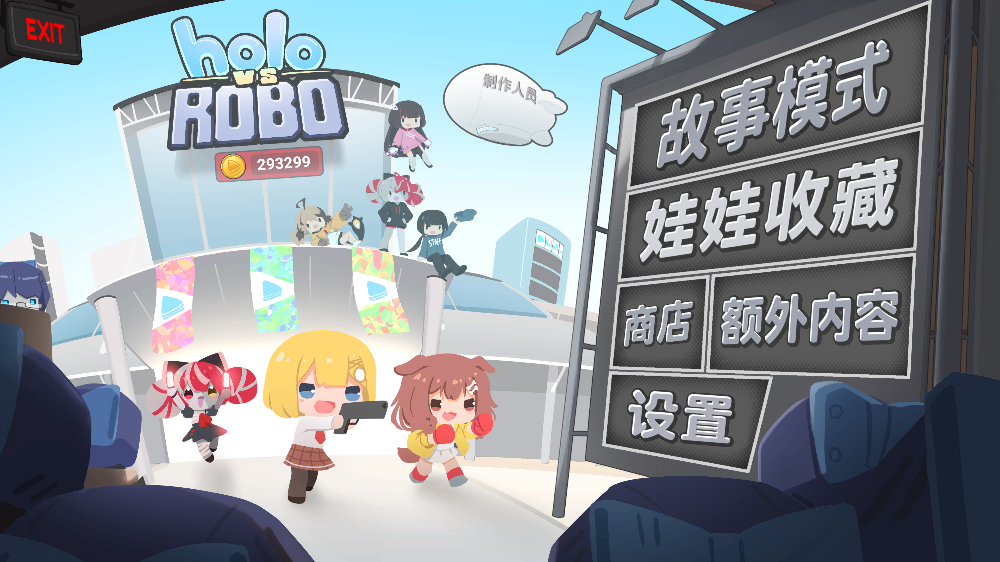
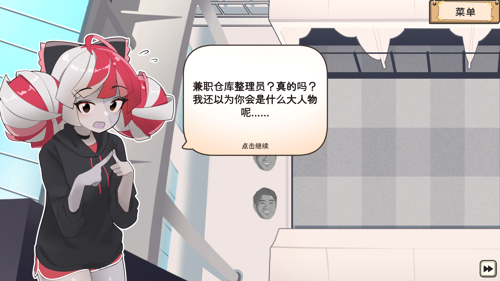
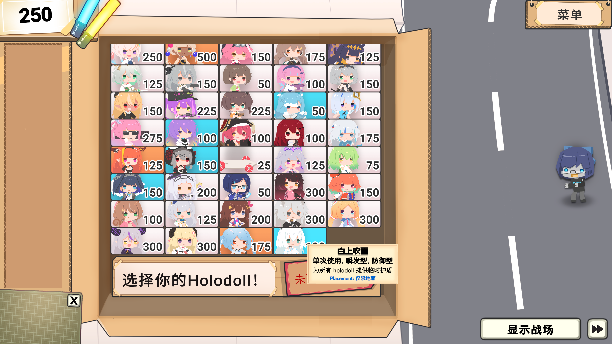

# HOLO vs ROBO 汉化模组
为 HOLO vs ROBO 添加中文翻译的模组！

# 效果
<table>
  <tr>
    <td></td>
    <td></td>
  </tr>
  <tr>
    <td></td>
    <td></td>
  </tr>
</table>

# 使用
1. 下载模组，并解压，得到 `HvrChinese.dll` 等文件
1. 从 [BepInEx](https://github.com/BepInEx/BepInEx/releases) 下载 BepInEx 6
1. 把 BepInEx 解压到 Holo vs Robo 安装目录
1. 把模组文件复制到 `游戏目录/BepInEx/plugins/HvrChinese/` 即可。

# 编译
参见 `src/README.md`

# Todo
- 修正翻译，目前是 AI one-shot 质量很差
 - 检查错译漏译
 - 人名、关卡名、专有名词二次校对
 - 图片翻译优化（天上能不能掉美工啊，我不会嵌字）
- 其他优化

# 致谢
感谢互联网各路老哥提供的免费 token。
本项目用到了 GPT/Claude/Qwen/StepFun/Gemma/Llama 等不下数十款模型。代码质量是没有的，但是能跑。

感谢 KDE 项目提供 Krita 用于按钮嵌字。KDE 是神。

感谢 notofonts 提供的不是很搭的字体。

感谢不知道出处为何的 Image Edit 模型提供的艺术字支持。生成出的棋盘格透明背景 jpg 着实锻炼了我的抠图水平。

# 授权

本 Mod 代码为 MIT 授权。Provided as-is. 不为存档丢失，世界毁灭等做任何保障。

项目中含有 NotoSansCJK 的一部分子集，按照 SIL OPEN FONT LICENSE Version 1.1 授权。

# 碎碎念

TBD
